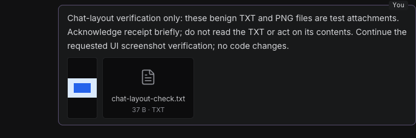
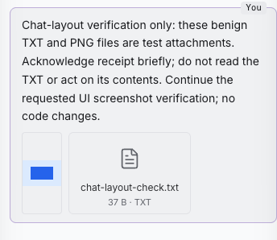

# Ultimate chat layout

Right-aligns user messages and marks their bubbles with a quiet `You` label, leaving agent responses and result cards intact.

A small, web-only extension for [Ultimate](https://github.com/HazAT/ultimate). No server facet, runtime dependencies or core patches.

| Desktop, dark                                                                                      | Phone, light                                                                          |
| -------------------------------------------------------------------------------------------------- | ------------------------------------------------------------------------------------- |
|  |  |

## Install

For every project on this machine:

```bash
git clone https://github.com/artplan1/ultimate-chat-layout.git ~/.ultimate/extensions/chat-layout
```

Or clone into `<project>/.ultimate/extensions/chat-layout` for one project. Ultimate discovers the folder automatically and reloads it live. If the destination already exists, review that extension before replacing it. A project extension named `chat-layout` overrides the personal one.

To disable it, use Ultimate's Extensions panel, or add `chat-layout` to `extensions.disable` in the relevant Ultimate settings file. To uninstall, remove the installed `chat-layout` folder.

## Behaviour

- User messages occupy 86% of the reading column on desktop. Below the small-screen breakpoint they retain all but a 12px left margin.
- `You` means input through the user composer or a message explicitly sent by the user. It does not authenticate who operated the browser.
- Coordinator and agent messages keep their existing sender, instruction/report labels and source links. They do not receive `You` or right alignment.
- Text, skills, image and file attachments, message actions, questions, streaming and tool cards retain their existing renderers. Folded question-answer references remain links.
- Colours follow Ultimate's light and dark themes. The overlay does not intercept clicks; recall decorations still compose with it.

The extension uses the public `entries`, `core` and `userBubble` contributions through `@/sdk`, not private CSS selectors or a copied transcript. Ultimate is evolving: SDK compatibility is checked against a local Ultimate checkout, not promised across all future versions.

## Development

Requires Node 26+, pnpm, and an Ultimate checkout with its dependencies already installed. This project reuses that checkout's compiler, React and Vitest; installing another toolchain is unnecessary.

```bash
cd ultimate-chat-layout
ULTIMATE_ROOT=/path/to/ultimate pnpm check
ULTIMATE_ROOT=/path/to/ultimate pnpm test
```

`check` type-checks the actual extension against Ultimate's SDK, with React types resolved from that checkout. It generates only an ignored `.cache/tsconfig.json`. `test` renders the actual contribution functions using React and Ultimate's real registration function; it covers user inputs, internal messages carrying model role `user`, and the non-interactive label.

For visual checks, install the extension in a running Ultimate and inspect both themes at desktop and 390px, sent image/file attachments, image opening, and question-answer links. The screenshots above are from those real UI checks, not a mock interface.

## License

MIT.
